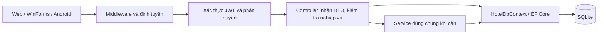

# Vấn đáp HotelManagementAPI

## 1. Giới thiệu trong khoảng một phút

“Đề tài của em là hệ thống quản lý khách sạn, dùng ASP.NET Core 8 Web API, Entity Framework Core và SQLite. Website, WinForms cho nhân viên và Android cho khách cùng gọi một API. Hệ thống quản lý phòng, khách hàng, đặt phòng, dịch vụ và thanh toán. JWT dùng để xác thực, còn role và kiểm tra chủ sở hữu dùng để phân quyền. Controller được tổ chức thành sáu nhóm nghiệp vụ để dễ đọc và bảo trì.”

Đây là ứng dụng Web API dùng chung cơ sở dữ liệu, không phải kiến trúc microservices. Một số Controller truy cập `HotelDbContext` trực tiếp; nghiệp vụ dùng chung được đặt trong các lớp thuộc `Services`.

## 2. Bản đồ sáu nhóm

| Nhóm | File nên mở đầu tiên | Giải thích ngắn |
| --- | --- | --- |
| Xác thực | [AuthController](../Controllers/Authentication/AuthController.cs) | Nhân viên đăng nhập, nhận JWT, đổi mật khẩu |
| Phòng | [RoomsController](../Controllers/Rooms/RoomsController.cs) | CRUD, tìm kiếm, lọc, sắp xếp, phân trang |
| Booking | [BookingsController](../Controllers/Bookings/BookingsController.cs) | Tìm phòng trống, đặt phòng, check-in/check-out/hủy |
| Thanh toán | [BookingOperationsController](../Controllers/Payments/BookingOperationsController.cs) | Thu/hoàn, hóa đơn, giữ chỗ, webhook SePay |
| Khách hàng | [CustomerPortalController](../Controllers/Customers/CustomerPortalController.cs) | Khách chỉ xem booking thuộc hồ sơ của mình |
| Vận hành | [ServicesController](../Controllers/Operations/ServicesController.cs) | Danh mục dịch vụ và ghi nhận lượt sử dụng |

Danh sách đủ 19 Controller nằm trong [Controllers/README.md](../Controllers/README.md). Tên thư mục không xác định role: chẳng hạn nhóm `Operations` có API cho nhân viên và API chỉ cho Admin.

## 3. Một request đi qua những đâu?



Kết quả trả về là HTTP status cùng JSON, hoặc nội dung file với API tải ảnh/sao lưu. `[ApiController]` hỗ trợ model binding và tự trả lỗi khi DTO không hợp lệ; middleware xử lý các lỗi chung. Endpoint công khai có thể dùng `[AllowAnonymous]`.

## 4. Ba luồng nên trình bày được

### A. CRUD phòng

Mở [RoomsController](../Controllers/Rooms/RoomsController.cs), [DTOs/Requests.cs](../DTOs/Requests.cs) và [HotelDbContext](../Data/HotelDbContext.cs).

| HTTP | Route | Công việc |
| --- | --- | --- |
| GET | `/api/Rooms` | Danh sách phòng, lọc và phân trang |
| GET | `/api/Rooms/{id}` | Chi tiết một phòng |
| POST | `/api/Rooms` | Tạo phòng, trả `201` và Location |
| PUT | `/api/Rooms/{id}` | Cập nhật phòng |
| PATCH | `/api/Rooms/{id}/trang-thai` | Thay đổi trạng thái theo điều kiện nghiệp vụ |
| DELETE | `/api/Rooms/{id}` | Xóa phòng chưa có lịch sử, trả `204` |

Ví dụ đọc danh sách:

```http
GET /api/Rooms?pageNumber=1&pageSize=10&keyword=20&sortBy=price_asc
Authorization: Bearer <JWT nhân viên>
```

`List` tạo `IQueryable`, áp dụng `Where`, đếm bằng `CountAsync`, sắp xếp rồi lấy trang bằng `Skip`/`Take`. `Include` lấy hạng phòng; `AsNoTracking` phù hợp truy vấn chỉ đọc. Dữ liệu trả qua `ApiSupport.RoomView` và `ApiSupport.Page`, không trả nguyên đối tượng EF cùng các quan hệ.

Khi tạo phòng: nhận `RoomSave` → kiểm tra hạng phòng → tạo entity → `SaveChangesAsync` → `CreatedAtAction`. Trùng số phòng trả `409`. Xóa phòng có lịch sử booking cũng bị chặn để giữ dữ liệu nghiệp vụ.

### B. Đặt phòng và nhận/trả phòng

Mở [BookingsController](../Controllers/Bookings/BookingsController.cs), [BookingHolds](../Services/BookingHolds.cs) và [HotelWorkflow](../Services/HotelWorkflow.cs).

1. `GET /api/Bookings/available-rooms` kiểm tra ngày, số khách và lịch trùng.
2. Nhân viên tạo qua `POST /api/Bookings`; khách đăng nhập tạo qua `POST /api/Bookings/public`.
3. Server kiểm tra lại phòng trong transaction, tính số đêm và chốt đơn giá trong `BookingDetail`.
4. Booking khách mới có yêu cầu thanh toán được giữ chỗ 30 phút; `BookingHolds` xử lý hết hạn theo điều kiện thanh toán. Booking cũ và booking nhân viên không mặc nhiên có cùng thời hạn này.
5. Check-in/check-out kiểm tra trạng thái; check-out chốt nghiệp vụ hóa đơn và chuyển phòng sang chờ dọn. `HousekeepingController` xác nhận dọn xong trước khi phòng trở lại sẵn sàng.

Khoảng ở dùng điều kiện trùng: `ngàyNhậnCũ < ngàyTrảMới && ngàyNhậnMới < ngàyTrảCũ`. Vì thế khách mới có thể nhận vào ngày khách cũ trả, nếu trạng thái phòng và các điều kiện khác cho phép. Ngày quá khứ bị chặn ở server theo múi giờ khách sạn.

### C. Thu tiền và SePay

Mở [BookingOperationsController](../Controllers/Payments/BookingOperationsController.cs) và [BankTransferReconciliation](../Services/BankTransferReconciliation.cs).

- Thu tiền mặt do nhân viên ghi nhận; chuyển khoản có thể được xác nhận qua webhook SePay.
- Webhook dùng API key riêng, kiểm tra ngân hàng, tài khoản chính/VA khi cấu hình, chiều giao dịch và dữ liệu giao dịch. Nó không dùng JWT khách hàng.
- Request ID và định danh giao dịch giúp chống ghi trùng khi client hoặc SePay gửi lại; kiểm tra kết hợp với transaction và ràng buộc database.
- Giao dịch không xác định rõ booking được lưu chờ đối soát, không tự chọn booking đầu tiên.
- `success: true` là đã tiếp nhận giao dịch bền vững; phải xem trạng thái đối soát để biết tiền đã gắn vào booking hay chưa.

Không trình diễn bằng cách chuyển tiền thật khi vấn đáp. Dùng database thử và các harness trong `tests`.

## 5. Câu hỏi thường gặp và câu trả lời ngắn

**Controller có nhiệm vụ gì?** Nhận HTTP request, bind/kiểm tra DTO, thực hiện hoặc gọi nghiệp vụ, rồi trả HTTP response. Controller không phải bảng trong database.

**`[Route("api/[controller]")]` nghĩa là gì?** `[controller]` lấy tên lớp bỏ hậu tố `Controller`: `RoomsController` thành `/api/Rooms`. `[HttpGet("{id:int}")]` bổ sung đoạn ID và ràng buộc số nguyên. Chuyển file sang thư mục con không đổi route.

**DTO khác entity thế nào?** DTO quy định dữ liệu đầu vào như `RoomSave`, `BookingCreate`; entity mô tả dữ liệu lưu qua EF Core. DTO giới hạn trường client được gửi và có validation. Các response view còn tránh trả `PasswordHash` hoặc vòng lặp quan hệ.

**Validation ở đâu?** Data Annotations trong DTO kiểm tra trường bắt buộc, độ dài, khoảng giá trị; Controller/service kiểm tra nghiệp vụ như lịch trùng và trạng thái. Không chỉ kiểm tra bằng JavaScript vì request có thể gửi trực tiếp.

**Phân trang để làm gì?** Giới hạn số bản ghi mỗi lần lấy. `PageQuery` mặc định trang 1, 20 dòng; giới hạn tối đa 100 dòng. Response có `totalCount`, `pageNumber`, `pageSize`, `totalPages`, `items`.

**EF Core làm gì?** `HotelDbContext` ánh xạ entity và quan hệ, tạo truy vấn SQL, theo dõi thay đổi và ghi vào SQLite. Migrations quản lý thay đổi schema; không phải thao tác xóa database rồi tạo lại mỗi lần chạy.

**Vì sao dùng `async/await`?** Cho phép chờ thao tác I/O mà không giữ luồng xử lý request chờ đồng bộ. Nó không có nghĩa mọi truy vấn được chạy song song; một `DbContext` không được dùng đồng thời cho nhiều truy vấn.

**Vì sao cần transaction?** Một nghiệp vụ có nhiều bước liên quan phải thành công cùng nhau. Ví dụ kiểm tra lịch rồi tạo booking cần tránh hai request cùng chiếm phòng. Transaction được kết hợp với kiểm tra nghiệp vụ và ràng buộc database; không thay thế chúng.

**JWT xác thực khác phân quyền thế nào?** Xác thực xác định ai đang gọi API; `[Authorize(Roles = ...)]` xác định họ được làm gì. `Roles.Staff` gồm `Admin,Receptionist`. API của khách còn đối chiếu chủ sở hữu booking, không chỉ xem role.

**JWT cũ sau khóa/mở tài khoản có dùng lại được không?** Server kiểm tra trạng thái tài khoản và dấu trạng thái phiên qua `StaffTokenState`/`CustomerTokenState`. Với nhân viên, thay đổi phiên khi khóa giúp token cũ không sống lại sau mở khóa.

**Mật khẩu lưu thế nào?** Lưu BCrypt hash, không lưu bản rõ. Giới hạn 72 byte UTF-8 được kiểm tra ở DTO/chính sách mật khẩu để tránh BCrypt cắt ngầm. Mật khẩu khởi tạo Admin do cấu hình cung cấp và buộc đổi lần đầu.

**Upload ảnh đã kiểm tra gì?** `RoomPresentationController.Upload` yêu cầu Admin, giới hạn file 5 MB, kiểm tra chữ ký đầu file JPG/PNG/WebP, sinh tên GUID và lưu theo phòng. Khi phục vụ ảnh, tên file được kiểm tra bằng mẫu cố định. Đây không phải bộ quét virus hoặc bộ giải mã toàn bộ ảnh.

**Lỗi HTTP thường gặp?** `400`: dữ liệu sai; `401`: chưa xác thực/token không hợp lệ; `403`: không đủ quyền; `404`: không có tài nguyên; `409`: xung đột nghiệp vụ; `500`: lỗi ngoài dự kiến. `ApiErrorMiddleware` chuẩn hóa lỗi, hỗ trợ trace ID và tránh trả stack trace cho client.

**Ghi log ở đâu?** Cấu hình log JSON trong `Program.cs`; middleware theo dõi request và `ApiErrorMiddleware` ghi lỗi với trace ID. Có thêm audit nghiệp vụ. Không ghi mật khẩu, API key hoặc JWT vào log.

**Đã kiểm thử SMTP và ngân hàng thật chưa?** Bộ test tự động dùng dữ liệu tạm, không chứng minh đã gửi SMTP thật. Trước đó một giao dịch SePay thật đã được đối soát và ghi nhận sau khi sửa VA; không suy ra mọi tình huống ngân hàng/hoàn tiền đều đã được thử thật. Phải phân biệt kiểm thử giả lập, tích hợp local và kiểm chứng dịch vụ thật.

## 6. Chuẩn bị demo

1. Dùng database thử; đăng nhập nhân viên và giải thích JWT/role.
2. Demo phòng: thêm → lọc/sắp xếp/phân trang → sửa → xóa phòng chưa có lịch sử.
3. Demo booking: tìm phòng → tạo → thử đặt trùng để nhận `409` → xử lý nhận/trả phòng theo điều kiện.
4. Gửi request không có token hoặc token sai quyền để phân biệt `401`/`403`; thử dữ liệu sai để xem `400`.
5. Mở `tests/run-native-clients.mjs` để giải thích các kiểm thử gọi API thật trên server/database tạm.

Lệnh kiểm tra từ thư mục gốc project:

```powershell
dotnet build HotelManagementAPI.csproj -c NativeClients /p:UseAppHost=false
dotnet build .\clients\HotelManagement.Client.Checks\HotelManagement.Client.Checks.csproj -c Release
$env:HOTEL_TEST_DLL = (Resolve-Path .\bin\NativeClients\net8.0\HotelManagementAPI.dll).Path
node .\tests\run-native-clients.mjs
```

Khi được hỏi sâu, mở đúng file và giải thích đoạn mã thực tế; tài liệu này là bản đồ học, không thay thế việc hiểu code.
